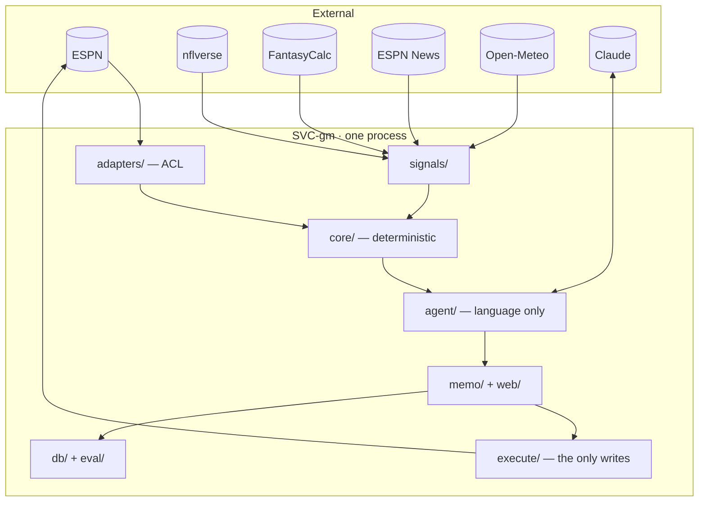

# Architecture — Fantasy GM

> **Generated from `model/` at `341cc3c` on `2026-10-01`. Do not edit.**
> Corrections go into `model/architecture/` or `model/nfrs.md`, then regenerate.

*Audience: anyone about to change this system, and anyone deciding whether it is safe to run.*

## What this is

A single Python process with two entry points, holding six bounded contexts as modules. One user, one league, one laptop.

This document describes a system that already exists, so most of it is a record rather than a target. The parts worth reading are the ones where **the code and the intent disagree** — those are collected under "Known gaps" and they are the output of this stage, not an appendix to it.

**One service, six contexts.** Splitting them would buy independent deployment and scaling, and this system needs neither — the decision cadence is measured in days. What the contexts buy is module boundaries, enforced by import discipline. That folding is defensible on its merits, but see the first known gap: import discipline with nothing testing it has already drifted once.

---

## The stack

| Layer | Choice | Why it is here |
| --- | --- | --- |
| Language | Python 3.11 | The core is numeric and the ecosystem is Python-native |
| Build | uv | Lockfile-based. Lives at `~/.local/bin/uv`, *not* on the default PATH |
| Agent | LangGraph 1.x | The checkpointer makes a run replayable; the graph makes propose→approve→execute explicit rather than implied |
| Model | Claude Haiku 4.5 | Chosen on observed tool-calling reliability, not raw capability. Pluggable to Google or Groq |
| Store | SQLite ×2 | Decision log and graph checkpoints. No concurrent writers, so no server |
| Cache | Parquet on disk | nflverse pulls are large and refresh a few times a day |
| Data | Polars, confined to `signals/sources/` | The core consumes plain dicts so it stays pure and testable |
| Types | Pydantic v2 | `models.py` is the contract between every layer |
| Web | FastAPI + Jinja2 + vendored htmx | No Node, no build step, no frontend toolchain |
| Tests | pytest, 545 passing | The core is tested against fixtures with no network |

Two choices are worth revisiting later. **LangGraph** is the heaviest dependency by a wide margin and earns it through the checkpointer alone — the hand-written loop it replaced was about sixty lines. **The model default** contradicts the decision record: D-012 argues for Opus 5 at high effort, the code runs Haiku 4.5, and the code has the better reason (reliable multi-tool calling, settled by observation). The decision record is the thing that is stale.

---

## Cross-cutting rules

These hold everywhere and are the spine of the design.

| Concern | Rule |
| --- | --- |
| Numeric integrity | Every number is computed in ordinary Python. The model turns language into structured signals and never does arithmetic |
| Irreversible actions | No write without an explicit per-execution confirmation typed by the manager. Dry run is always the default; authorisation is never persisted |
| Write verification | A write is believed only after reading state back. ESPN can return success without acting |
| Signal provenance | Every external value carries its source and timestamp, inseparably |
| Replay integrity | Every decision stores the inputs it saw, frozen. Nothing rewrites them |
| Risk posture | A deterministic `must_win`/`coast`/`normal` computed from record and weeks remaining, passed into supervised runs as an input. Deliberately *not* baked into the optimizer objective |
| Degradation over failure | A missing source is a reason to hedge or abstain, not to crash |
| LLM cost ceiling | 3 calls per run by default, with one held in reserve so the agent can always explain itself |

---

## Where the modules and the contexts disagree

The contexts are enforced by import discipline alone. These are the places that has not held.

| Context | Status |
| --- | --- |
| Signal Kernel | **Clean.** The anti-corruption layer really does stop at the adapter |
| Decision Analysis | **One dead module.** `core/waivers.py` is imported by nothing, and its constraint function admits in a comment that it cannot enforce the roster-size rule it claims to check |
| Lineup Execution | **Split three ways.** Plan in `execute/`, gate in `memo/cli.py:49`, and an independent second gate in `web/routes/approve.py:170`. Neither imports the other |
| Waiver Execution | **Absent, but the socket exists.** The web dispatcher rejects any run kind outside its worker registry, so adding waivers means registering a worker, not inventing dispatch |
| Trade Execution | **Clean,** and now confirms its own writes |
| Decision Ledger | **Clean.** `db/` records, `eval/` interprets |

---

## Data

Two SQLite files and two disk caches.

| Store | Holds |
| --- | --- |
| `decisions.db` | **Two tables.** `decisions` — every decision with its frozen input snapshot, the human response, the eventual outcome. `scorecards` — the computed weekly evaluation, keyed on week and season |
| `langgraph.db` | Graph checkpoints per run thread. Makes a run resumable |
| `data/cache/nflverse/` | Parquet. 6h TTL, 1h for weekly rankings, 7d for the id crosswalk |
| `data/cache/espn/` | ESPN read responses, per-entry TTL |

**Three aggregates share the `decisions` table**, discriminated by type with their payloads in JSON columns. This is a deliberate acceptance: the domain model splits them because their lifecycles genuinely differ, but a log of differently-shaped things is still a log. The cost is that claim- and offer-specific states live inside JSON and are not queryable. `scorecards` is the counter-example in the same file — the evaluation metrics *are* real columns, because they are what gets queried across weeks.

Revisit when a question like "how many claims did I lose to priority" needs answering without a table scan and a JSON parse. Not before.

---

## Integration and failure

Six external systems, none with a contract we control. Only ESPN gets an anti-corruption layer — everything else is a passive consumer, because there is no leverage to be anything else and no cost to conforming.

| When this is down | The product still | It cannot | You see |
| --- | --- | --- | --- |
| **ESPN reads** | nothing useful | produce any recommendation | An explicit failure. ⚠ See gaps — this path is an unhandled error today, not a graceful degradation |
| **ESPN writes** | recommend, brief, gate, log | execute | Browser fallback, then the exact moves to make by hand |
| nflverse | recommend from ESPN projections | grade matchup, schedule, usage | A brief naming the missing grades, with lower confidence |
| FantasyCalc | everything but market values | anchor trades to market prices | Value columns dropped entirely, never a stale price shown as current |
| ESPN news | everything deterministic | interpret late news | A note that none was available |
| Tavily | everything else | targeted research | A message naming what went unresearched |
| Weather | everything else | adjust for game environment | Nothing — the only degradation you would not notice |
| LLM provider | nothing | produce any recommendation | A provider error. The deterministic core still works via `show-week` |

**No retries on either write path, deliberately.** A retried lineup write fights the browser fallback for the same slot; a retried trade send creates a second pending offer the counterparty can accept. Reads retry freely because they are idempotent and free.

---

## Budgets

Every number traced to a file and line, or marked unmeasured.

| What | Budget | Where it comes from |
| --- | --- | --- |
| Weekly lineup run | under 5 min target, **unmeasured** | No instrumentation exists. LLM latency dominates |
| Season backtest | under 2 min, warm cache | Currently returns in seconds |
| ESPN request pacing | 1/second | Sleep in `_fetch` (`adapters/espn.py:113`). The value is a constructor default and a caller may lower it |
| LLM calls per run | 3, plus one reserved | `agent/config.py:75` |
| Provider ceilings | Anthropic 20/min · Google 4/min · Groq 1/min | Free-tier limits, not choices |
| Lineup deadline | Sunday 1PM kickoff | League rules. ⚠ Nothing watches this clock |
| Waiver deadline | Tuesday night | League rules. No waiver path exists yet |
| Write verification | Read state back, always | Invariant, implemented on both paths |

**Scale envelope:** one manager, one 12-team league, one season, a handful of decisions a week. Single process, SQLite, in-memory run registry, one worker, no auth — several of these break on the *second* of anything.

---

## Known gaps

The output of this stage. Each is a place the system differs from what someone reading the code would reasonably assume.

**1. The loopback bind is not a control.** `host="127.0.0.1"` is a default argument inside `main()` (`web/app.py:63`). `create_app` enforces nothing, so serving the app any other way — `uvicorn` directly, a container, an IDE run button — listens on all interfaces with the unauthenticated write form intact. That form holds ESPN session cookies that can modify a real roster. The honest statement is that there is no access control, only one entry point whose defaults happen to be safe.

**2. `decisions.db` has no backup and nothing detects its loss.** It holds both the decision log and the computed scorecards — the raw record and the derived evaluation. Every other failure in this document is recoverable. This one ends the season's evidence. It is also the cheapest thing here to fix.

**3. The approval gate is implemented twice.** Two independent copies of the only thing standing between the agent and an irreversible write, with only the web copy tested and nothing asserting they agree. This is the drift that the single-service folding predicted, already arrived.

**4. Abstention cannot currently trigger.** It is named as the degradation strategy for ESPN read failures, but the freshness thresholds that would fire it do not exist. A mitigation that cannot fire is not a mitigation.

**5. Two SQLite files can disagree** — a checkpoint claiming a run that left no decision row, or the reverse. Neither is detected and nothing says what it would mean.

**6. `core/waivers.py` looks like waiver support and is not.** Dead code whose one constraint function cannot enforce the rule it claims to.

---

## Open questions

| # | Question | Blocks |
| --- | --- | --- |
| H-02 | What freshness threshold makes each signal too stale? | Abstention, and therefore the ESPN-read degradation story |
| H-05 | Is the replacement baseline the whole roster, or only startable slots? | Every number waiver scoring produces |
| H-03 | Does waiver scoring need to model priority order? | Whether it can recommend players we were never going to get |
| H-06 | Is anything watching the clock? | The deadline-miss path |
| H-08 | What stops a brief asserting a number the optimizer never computed? | Invariants exist on all three brief-generating aggregates; nothing enforces them |
| H-01 | When both write paths fail, how does the manager find out in time? | The exhausted state has no notification behind it |
| H-04 | Who initiates a trade — agent scan, or manager ask? | The trade journey's trigger |
| H-07 | Can the system tell a refused offer from an unanswered one? | Trade outcome logging |

**H-02 and H-05 are the two that block waiver work.** Each decides what a number means, and neither is implementation detail.
