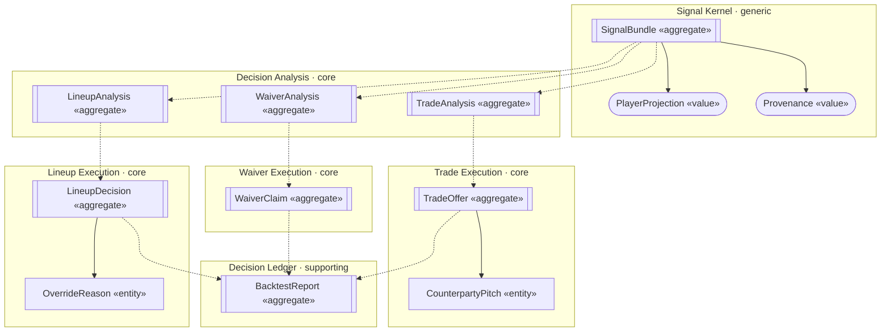
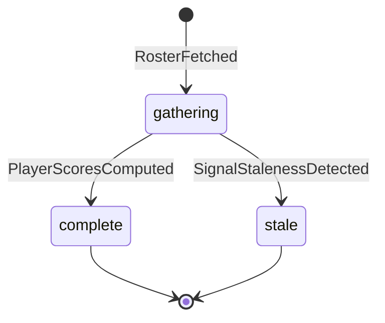
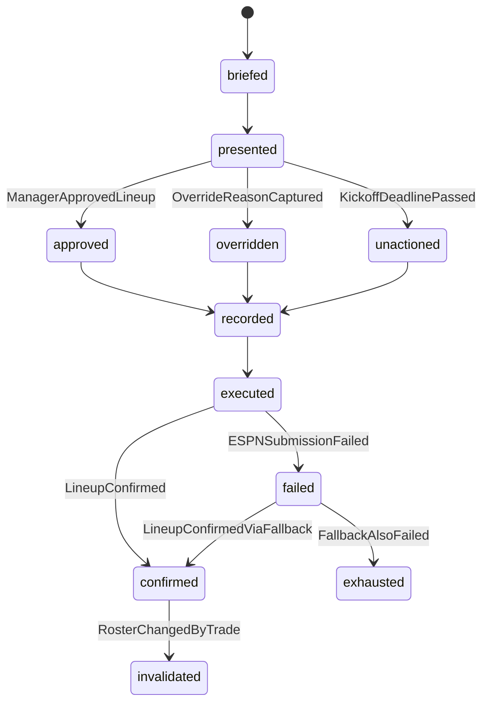
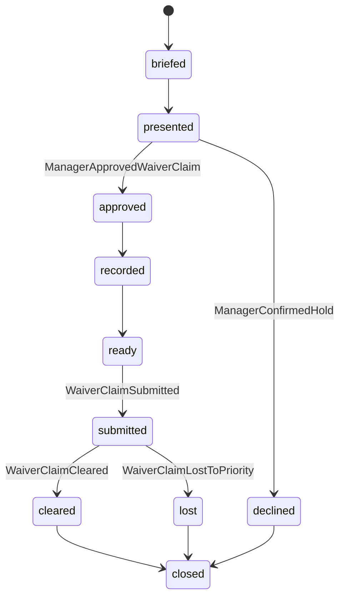
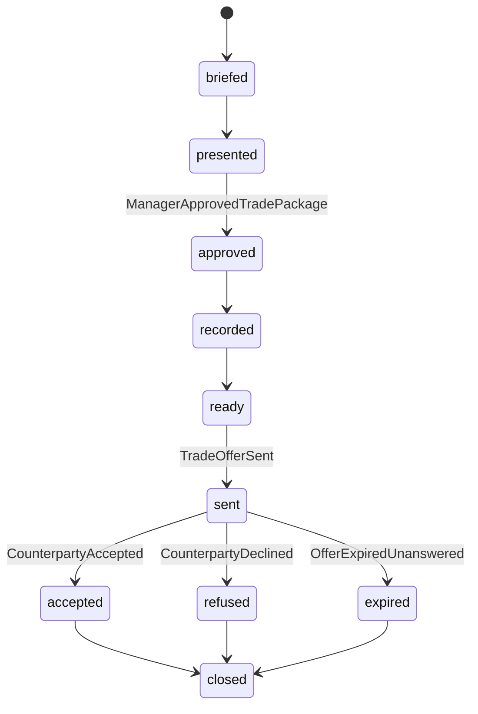
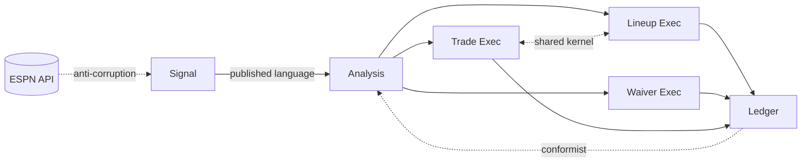

# Domain Design — Fantasy GM

> **Generated from `model/` at `f97488a` on `2026-10-01`. Do not edit.**
> Corrections go into `model/domain-model/`, `model/ubiquitous-language.md`,
> or `model/contexts.md`, then regenerate.

*Audience: anyone about to write code against this model, or anyone who needs to know what the words mean.*

## The shape of the domain

Six contexts. One gathers data, one computes, three act, one remembers.

The asymmetry worth noticing: **one analysis context, three execution contexts.** Analysis is whole because trade valuation calls the lineup optimizer directly — splitting it would put a cross-boundary call inside a calculation. Execution is split because the three differ in whether the system can write at all, whether the write is reversible, and who decides the outcome.

---

## The language

**Read this section even if you read nothing else.** These words mean something specific here, and using them loosely is how two parts of the system end up disagreeing about what a number is.

### Terms that are easy to get wrong

| Term | Means | Does *not* mean |
| --- | --- | --- |
| **Score** | Nothing on its own — always qualify it | There are five in one scorecard. Never use it bare |
| **Optimizer score** | What the agent's chosen lineup scored, having chosen with pre-game data only | Not the hindsight ceiling. The agent could not see the future |
| **Hindsight ceiling** | The best lineup that *could* have been set, computed after the fact | Not a target. Unreachable in advance by construction, so the gap to it is not a failure |
| **Decision regret** | Hindsight ceiling minus actual | Not evidence the agent was wrong — it is non-zero even for a perfect decision |
| **Value** | Nothing on its own — always qualify it | Means projected points, trade currency, or value above replacement depending on where you are |
| **Asset value** | Rest-of-season points × positional scarcity. The currency trades compare in | Not weekly points, and not a market price unless the source says market |
| **Value above replacement** | How much a candidate beats the worst slot it would displace, after the drop cost | Not raw projected points. A high projection can be worth nothing here |
| **Locked** | A player whose game kicked off. ESPN refuses to move them | Applies to players only. Players lock one at a time across Sunday |
| **Deadline passed** | The kickoff after which the standing lineup is what plays | Not "locked" — that is per-player |
| **Proposal** | What the agent suggests, before anything is sent | Never a sent trade. A proposal is reversible |
| **Offer** | A package actually sent to a counterparty | Crossing from proposal to offer is the point past which nothing can be undone |
| **Declined** | *We* chose not to file a waiver claim | Not a rejection by anyone else |
| **Refused** | The *counterparty* turned down our offer | Not "declined" — different actor, different word |
| **Abstain** | A deliberate refusal to recommend, carrying evidence | Not an error and not an empty result |
| **Dry run** | A full execution that builds the real payload and sends nothing | Not a simulation. The payload is real |
| **LIVE** | The literal string typed to permit a real write, per execution | Never a setting and never persisted |
| **Fairness** | The value ratio between the two sides, 0 to 1 | Not advice. A fair trade can be one to refuse |
| **Waiver priority** | Our position in the snake order | Not urgency and not a budget — this league has no FAAB |
| **Claim cleared** | Nobody ahead in priority wanted the same player | Not the normal outcome. Losing is ordinary |
| **Naive baseline** | Starting whoever the platform ranks highest, every week | Not a straw man. It is currently *ahead* of actual decisions |
| **Brief** | The readable explanation of a proposal | Not a place a new number may appear |
| **Input snapshot** | Everything the agent saw, frozen at decision time | Never updated. A refresh destroys the replay guarantee |

The score cluster is the one that will cause a real mistake. **Optimizer score** is what the agent achieved; **hindsight ceiling** is what an oracle would have achieved with information nobody had. They sit one line apart in the backtest output. Comparing the agent to the ceiling and calling the gap a failure is the most likely misreading of this entire model.

---

## The model

### SignalBundle · Signal Kernel

**Identity:** week + season + decision type — the three decision types gather different sources, so one bundle per week could never legitimately be "complete"

| # | Rule | Enforced in |
| --- | --- | --- |
| I-01 | Every signal carries a source and an as-of timestamp; one without provenance cannot enter the bundle | `SignalBundle.add` |
| I-02 | The bundle reports complete only if every member is within its own freshness threshold, and names the failures otherwise | `SignalBundle.assessFreshness` |

Projections are **value objects**, replaced wholesale on refresh and never edited. That is load-bearing: editing one in place would silently rewrite history and make every backtest run produce a different answer.

### LineupAnalysis · Decision Analysis

**Identity:** week + season

| # | Rule | Enforced in |
| --- | --- | --- |
| I-03 | Every optimized lineup is legal — eligible slots, every starter filled | `LineupAnalysis.optimize` |
| I-04 | A locked player keeps their slot. Moving one is a write ESPN rejects with 409 | `LineupAnalysis.optimize` |
| I-05 | An abstention names which signals were stale and by how much | `LineupAnalysis.abstain` |

Terminates at optimized or abstained. Everything after — brief, gate, write — belongs to lineup execution.

### LineupDecision · Lineup Execution

**Identity:** an opaque decision id. Week plus season cannot represent the *second* decision for a week, and there is one: a mid-week trade acceptance invalidates a confirmed lineup and forces a re-decide.

| # | Rule | Enforced in |
| --- | --- | --- |
| I-09 | A departure from the proposal carries a non-empty written reason; the transition is rejected without one | `LineupDecision.override` |
| I-10 | The input snapshot is written once and never updated | `LineupDecision.record` |
| I-11 | No ESPN write from a decision that is not approved or overridden | `LineupDecision.execute` |
| I-16 | A write is confirmed only by reading the roster back | `LineupDecision.confirm` |
| I-25 | Every number in a brief appears in the analysis it came from. A brief may rephrase a number, never introduce one | `LineupDecision.brief` |

The **override reason is an entity**, not a value object. Its whole purpose is to be individually addressable months later — the season review is the reason the system exists.

### WaiverAnalysis · Decision Analysis

**Identity:** week + season

| # | Rule | Enforced in |
| --- | --- | --- |
| I-06 | A candidate clears the replacement baseline *after* the drop cost, never before | `WaiverAnalysis.score` |
| I-17 | The no-candidate outcome names the closest candidate and the margin it missed by | `WaiverAnalysis.recommendHold` |

### WaiverClaim · Waiver Execution

**Identity:** an opaque claim id — the hold path has no player to add, and keying half the waiver history on a null makes a no-claim week unreviewable.

| # | Rule | Enforced in |
| --- | --- | --- |
| I-12 | An add requires a drop whenever the roster is at maximum | `WaiverClaim.approve` |
| I-18 | A claim records the priority position it was filed under | `WaiverClaim.submit` |
| I-19 | A hold is recorded with the same weight as a claim | `WaiverClaim.decline` |
| I-26 | Every number in a brief appears in the analysis it came from | `WaiverClaim.brief` |

`recorded` and `closed` are different on purpose. A claim in `recorded` still needs filing before the deadline; collapsing the two made that undetectable.

### TradeAnalysis · Decision Analysis

**Identity:** week + season + counterparty

| # | Rule | Enforced in |
| --- | --- | --- |
| I-07 | No ranking until expected value exists for every candidate. Ranking before the metric orders by nothing | `TradeAnalysis.rank` |
| I-08 | Both rosters legal after the trade | `TradeAnalysis.evaluate` |

### TradeOffer · Trade Execution

**Identity:** an opaque offer id. A revised offer is a *new* offer, so the natural key would make it an edit of the one already sent.

| # | Rule | Enforced in |
| --- | --- | --- |
| I-13 | Terms are immutable once sent; revising creates a new offer with a new identity | `TradeOffer.send` |
| I-20 | A sent offer records which package was chosen and keeps the ones that were not | `TradeOffer.send` |
| I-21 | Acceptance is terminal. No transition out exists and none may be added | `TradeOffer.accept` |
| I-22 | A package the counterparty refused is never offered again | `TradeOffer.send` |
| I-23 | A send is confirmed only by reading the league back. A non-error response is not evidence | `TradeOffer.confirm` |
| I-24 | No send without explicit per-send confirmation. Dry run is the default; authorisation is never persisted | `TradeOffer.send` |

**The system can send here, and this is the only write it cannot undo.** The first version of this model said trades could not be written at all — true when the original decision was recorded, and false since 25 September. The discovery pass caught the drift, and the read-back rule now exists because ESPN can return success without creating anything.

The **counterparty pitch is an entity**, because which pitch produced which answer is the one thing the value model cannot predict.

### BacktestReport · Decision Ledger

**Identity:** season + through-week

| # | Rule | Enforced in |
| --- | --- | --- |
| I-14 | Every projection used to score a past week predates that week's first kickoff. One post-hoc value invalidates the report | `BacktestReport.replay` |

A rule requiring the replay to reproduce a recorded decision was considered and **rejected as an invariant** — nothing can reject a transition on it, so it is a test of the implementation rather than a constraint on state. It belongs in a slice's acceptance criteria.

---

## Read models

| Read model | Serves | Built from | Freshness |
| --- | --- | --- | --- |
| RosterView | Manager | roster and signal fetches | ≤ 15 min, bounded by the slowest upstream |
| LineupBrief | Manager | optimize + brief | synchronous; never cached across runs |
| TradeBrief | Manager | rank + brief | synchronous, recomputed on read |
| WaiverBrief | Manager | best-add + brief | synchronous per run |
| BacktestScorecard | Manager | delta + scorecard | ≤ 1 week |
| OverrideLog | Manager | override capture + log | ≤ 1 week |
| UnactionedLog | Manager | deadline miss + forgone value | ≤ 1 week |
| ClaimHistory | Manager | submit, clear, lose | ≤ 1 week — one waiver cycle |

Two of these have freshness rules that are **correctness** requirements, not performance ones. The trade brief recomputes on read because market values move and a cached brief quotes a stale price — the web layer already behaves this way, dropping value columns entirely when FantasyCalc is unreachable rather than showing a cached number as current. The lineup brief is never cached across runs because a brief that outlives its run describes a roster that may have changed.

---

## How the contexts relate

| Upstream | Downstream | Pattern | What it means in practice |
| --- | --- | --- | --- |
| ESPN API | Signal Kernel | Anti-corruption layer | ESPN's undocumented shapes are translated at the adapter and stop there. Nothing above ever sees a raw payload |
| Signal Kernel | Decision Analysis | Published language | The scored bundle with freshness stamps is a stable contract; analysis does not know where a number came from |
| Decision Analysis | each execution context | Customer/supplier | Analysis supplies, execution consumes. Execution can ask for changes; analysis decides |
| each execution context | Decision Ledger | Customer/supplier | Every decision produces a record |
| Decision Ledger | Decision Analysis | Conformist | The backtest accepts the analysis model unchanged and absorbs its churn — deliberately, because replaying with a *different* optimizer would measure something else |
| Lineup Exec | Trade Exec | Shared kernel | Both resolve roster legality and starting-lineup value through the same optimizer call. Changing it changes both |

### Where we translate

| External term | Our term | Lossy? | What is lost |
| --- | --- | --- | --- |
| `statSourceId == 1` rows | PlayerProjection | **yes** | ESPN mixes projections and actuals in one collection, separated only by this discriminator. Read the wrong one and last week's results become this week's forecast |
| `lineupSlotId` integer | RosterSlot position | **yes** | An opaque, undocumented integer per slot kind. A new slot kind arrives as an unmapped integer, not an error |
| `scoringPeriodId` | Current week | no | Read straight through. Deliberately not derived from a calendar — ESPN's own notion of the week is authoritative |
| `injuryStatus` string | PlayerStatus | **yes** | Not one-to-one, and ESPN has added values mid-season. An unknown string must degrade to unknown, never to active |
| Player entry id | Player identity | **yes** | Bridges to nflverse via a third-party crosswalk. A player missing from it silently has no usage or injury data |
| `onTeamId` | Roster membership | no | Zero means unrostered, and it is the whole basis for availability |
| Scoring settings | ScoringRules | no | Read live and cached, never hardcoded — multipliers differ between leagues that both call themselves PPR |
| Write response body | Execution outcome | **yes** | A success status does not prove anything moved. Both write paths now read state back instead of trusting it |

Six of eight mappings are lossy. That is the real cost of integrating with an undocumented API, and it is stated rather than buried.

---

## Consistency checks

| Check | Result |
| --- | --- |
| Structural validation — references, duplicate ids, enums, size caps | **pass**, 0 errors |
| Every aggregate, entity and value object defined in the glossary | **pass** after the review added eight missing aggregate terms |
| Exactly one writer per aggregate | **pass** after the review split a shared decision record three ways |
| Every state reachable by a transition | **pass** |
| Every transition references an event that exists | **pass** |
| Every homonym split rather than merged | **pass** — score, value, declined/refused, locked/deadline all kept separate |
| Invariants written as something a test can assert | **pass** after one was removed for being a test, not a constraint |
| Every context pair that talks has a labelled, directed relationship | **pass** |

Both passes found real defects. The mechanical check found a decision record being written by three contexts and three aggregates written from outside their own context. The adversarial challenge found two aggregate identities that could not represent a second instance, and the model asserting that trades could not be written when the code had been writing them for a week.

## Open questions

| # | Question | Blocks |
| --- | --- | --- |
| H-09 | The trade send reported success without verifying — **now fixed in code**, invariant satisfied | — |
| H-02 | What freshness threshold makes each signal type too stale? | The freshness invariant has nothing to compare against, so abstention is unreachable |
| H-05 | Is the replacement baseline the whole roster, or only startable slots? | Every number waiver scoring produces |
| H-03 | Does waiver scoring need to model priority order, or only name a target? | Whether the scorer can recommend players we were never going to get |
| H-06 | Is anything watching the clock? A brief can go unread until kickoff | The deadline-miss path, and the waiver equivalent |
| H-08 | What stops a brief asserting a number the optimizer never computed? | Invariants now exist on all three brief-generating aggregates; nothing enforces them yet |
| H-01 | When both write paths fail, how does the manager find out in time? | The exhausted state has no notification behind it |
| H-04 | Who initiates a trade — does the agent scan, or does the manager ask? | The trade journey's trigger |
| H-07 | Can the system tell a refused offer from one still sitting unanswered? | Trade outcome logging |

All are owned by the manager, who is also the only user. **H-02 and H-05 are the two blocking waiver work** — each decides what a number means, and neither is implementation detail.
