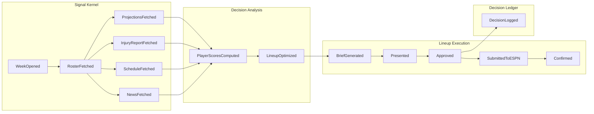
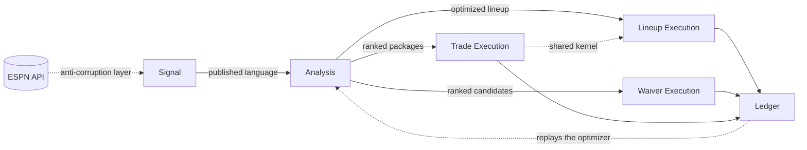

# Event Maps — Fantasy GM

> **Generated from `model/` at `5dc8ed3` on `2026-09-30`. Do not edit.**
> Corrections go into `model/event-maps/`, then regenerate.

*Audience: anyone picking this project up — what the system does, in the order it happens.*

## What this is

Fantasy GM runs the same shape of cycle for three different kinds of decision: who to start, who to claim off waivers, and who to trade for. The first two are weekly and deadline-bound; trades happen whenever a roster imbalance appears. A fourth cycle runs after the games to ask whether any of it worked.

Each is mapped below as the things that happen in it — first the way it goes when it goes well, then each way it diverges. Everything downstream (the domain model, the services, the delivery slices) derives from these maps.

**This model was re-cut after its first version was challenged and blocked.** The first pass reproduced the process lifecycle as its context boundaries, which is the failure mode of taking the archetype as the answer rather than as a prior. What follows is the second cut, derived from the events and from evidence in the existing code. The section on boundaries says what moved and why.

---

## Coverage

| Journey | Actor | Functions | Scenarios mapped | Named but unmapped |
| --- | --- | --- | --- | --- |
| Weekly lineup *(J-01)* | Manager | 18 | happy path · manager override · agent abstains · ESPN write fails · deadline missed | — |
| Trade offer *(J-02)* | Manager | 12 | happy path · counterparty answers | agent abstains · manager rejects all |
| Waiver claim *(J-03)* | Manager | 13 | happy path · nothing clears the bar · claim lost to priority | — |
| Performance review *(J-04)* | Manager | 7 | happy path | backtest comes back flat or negative |

All 33 functions are covered by at least one journey — no scope here has no route through it.

**Three scenarios remain named but unmapped.** The two trade divergences matter least, because that capability already ships. The negative-backtest case matters most: the current measured baseline says the naive approach is *ahead* by roughly three points a week, which makes it the likely branch rather than the exceptional one.

---

## The process end to end

Happy paths only, grouped by where the boundaries fell. Parallel branches are parallel because the model says so, not because of page layout.

The waiver and trade cycles share this spine — gather in parallel, join, analyse, brief, gate, act, log. What differs is the deadline and whether the system can execute the outcome at all.

---

## Journey by journey

### Weekly lineup · J-01

The only journey where the system can complete the action itself. Everything else ends with instructions for the manager.

**Happy path**

| Step | Event | Caused by | Waits on | |
| --- | --- | --- | --- | --- |
| 1 | **WeekOpened** ★ | Agent | — | Tuesday, after the prior week's games |
| 2 | RosterFetched | ESPN | WeekOpened | |
| 3a | ProjectionsFetched | ESPN | RosterFetched | *all four run together* |
| 3b | InjuryReportFetched | nflverse | RosterFetched | |
| 3c | ScheduleAndMatchupFetched | nflverse | RosterFetched | |
| 3d | NewsAndPracticeReportFetched | ESPN News | RosterFetched | |
| 4 | PlayerScoresComputed | Agent | all four signals | Blends projection, matchup, schedule, usage |
| 5 | **LineupOptimized** ★ | Agent | PlayerScoresComputed | Backtracking search over legal slot assignments |
| 6 | LineupBriefGenerated | Agent | LineupOptimized | Per-player reasoning with signals cited |
| 7 | **RecommendationPresented** ★ | Manager | LineupBriefGenerated | Nothing is recorded until the manager has seen it |
| 8 | **ManagerApprovedLineup** ★ | Manager | RecommendationPresented | The gate — no ESPN write exists without it |
| 9a | DecisionLogged | Agent | approval | *runs alongside 9b* |
| 9b | **SubmittedToESPN** ★ | ESPN | approval | Dry run unless the manager typed `LIVE` |
| 10 | LineupConfirmed | ESPN | submission | |

**When it diverges**

| Scenario | Kind | Branches at | Returns to | What happens |
| --- | --- | --- | --- | --- |
| Manager override | alternate | recommendation presented | LineupConfirmed | Manager substitutes a player and writes down why |
| Agent abstains | alternate | signals joined | **never** | Signals too stale to trust; manager acts unassisted |
| ESPN write fails | exception | submission | LineupConfirmed, *if the fallback works* | Browser automation takes over |
| **Deadline missed** | exception | recommendation presented | **never** | Nobody looked; kickoff locks the standing lineup |

Three of those four do not rejoin, and each is worth saying in words.

**The override path** produces the project's most valuable artifact. The written reason is mandatory, because at the end of the season that log is the only record of where the manager's judgement beat the model and where it did not.

**The abstention path ends deliberately.** The agent names which signals were stale, how stale, and what would change its mind, then stops. An agent that always answers is an agent whose confidence tells you nothing.

**The write-failure path is the highest-consequence branch.** The analysis was right, the manager approved, and the lineup still did not change — ESPN's endpoint is reverse-engineered and can fail silently, returning success while moving nothing. Browser automation is the second attempt. If that also fails the manager is told to act by hand, and whether that message arrives in time is unresolved *(H-01)*.

**The deadline-miss path is the most likely failure in the whole system and the first draft assumed it away.** The brief was generated and nobody read it. Kickoff passes, the standing lineup plays, and the week is gone. It is logged as its own outcome — distinct from an override and from an abstention — because "the agent was right and nobody found out" is a different fact from either. Nothing currently watches the clock *(H-06)*.

---

### Trade offer · J-02

Shares the spine until the end, where it hands off entirely: ESPN requires the counterparty to accept, so there is no send path and none should be built.

| Step | Event | Caused by | Waits on | |
| --- | --- | --- | --- | --- |
| 1 | **TradeOpportunityIdentified** ★ | Agent | — | 🔴 Who triggers this is unresolved *(H-04)* |
| 2a | RoSValuesRetrieved | FantasyCalc | trigger | *all three together;* network call, may be down |
| 2b | RosterNeedsAssessed | Agent | trigger | Surplus and deficit against league replacement level |
| 2c | NewsAndInjuryContextFetched | ESPN News | trigger | |
| 3 | **TradePackagesGenerated** ★ | Agent | all three | Candidates, *unranked* — the ranking metric doesn't exist yet |
| 4 | TradeEVComputed | Agent | candidates | Rest-of-season value × positional scarcity |
| 5 | LineupImpactAssessed | Agent | EV | Optimizer re-run on the post-trade roster |
| 6 | TradePackagesRanked | Agent | lineup impact | *Now* rankable — top 3 kept |
| 7 | TradeBriefGenerated | Agent | ranking | Rationale plus a pitch aimed at the counterparty |
| 8 | **ProposalPresented** ★ | Manager | brief | Every package with its EV and fairness |
| 9 | **ManagerApprovedTradePackage** ★ | Manager | proposal | Manager picks one |
| 10a | DecisionLogged | Agent | approval | Records *which* package, for the season review |
| 10b | InAppStepsGenerated | Agent | approval | |
| 11 | TradeOfferReadyToSend | Manager | steps | |
| 12 | **TradeOfferSent** ★ | Manager | ready | Sent in the ESPN app. Visibility ends here |

**When the counterparty answers**

Accept, decline, and expire are modelled as three sibling outcomes of one moment — the point where something we do not control becomes fact. They are siblings, not a sequence: nothing waits on acceptance to find out about a decline.

| Outcome | What follows |
| --- | --- |
| **Accepted** | Both rosters change. Irreversible — the only truly irreversible thing in the product. And it invalidates any lineup recommendation already on screen, which re-enters the lineup journey from the start |
| **Declined** | Rosters unchanged |
| **Expired unanswered** | Rosters unchanged, and 🔴 the system may never learn this happened *(H-07)* |

All three converge on one logged outcome, because whether the *pitch* worked is the one thing the EV model cannot predict and the only place to learn it.

**Unmapped:** the agent finding no favourable trade, and the manager rejecting every package. Both are common — of 35 logged trade decisions, 22 were abstentions. Leaving the abstention path unmapped while it is the majority outcome is a gap worth closing before this journey is touched again.

---

### Waiver claim · J-03

The main unbuilt capability. Structurally it mirrors the lineup cycle, with one difference: the replacement baseline has to be computed before candidates can be scored against it, so it joins the parallel signal wave rather than following it.

| Step | Event | Caused by | Waits on | |
| --- | --- | --- | --- | --- |
| 1 | **WaiverWireOpened** ★ | Agent | — | Tuesday night, after Monday Night Football |
| 2 | AvailablePlayersScanned | ESPN | wire open | Filtered to positions the roster needs |
| 3a | ProjectionsForCandidatesFetched | ESPN | scan | *all four together* |
| 3b | InjuryStatusForCandidatesFetched | nflverse | scan | |
| 3c | ScheduleStrengthForCandidatesFetched | nflverse | scan | |
| 3d | ReplacementBaselineComputed | Agent | scan | The bar a new player has to clear |
| 4 | WaiverCandidatesScored | Agent | all four | Value above replacement under league scoring |
| 5 | **BestAddIdentified** ★ | Agent | scoring | |
| 6 | WaiverRecommendationGenerated | Agent | best add | Names the add *and* the drop |
| 7 | **RecommendationPresented** ★ | Manager | recommendation | Before the deadline |
| 8 | **ManagerApprovedWaiverClaim** ★ | Manager | presentation | Confirms both sides of the move |
| 9a | DecisionLogged | Agent | approval | |
| 9b | InAppStepsGenerated | Agent | approval | |
| 10 | WaiverClaimReadyToSubmit | Manager | steps | |
| 11 | **WaiverClaimSubmitted** ★ | Manager | ready | Filed. Priority order decides from here, not us |
| 12 | **WaiverClaimCleared** ★ | ESPN | submission | Nobody ahead wanted the same player |
| 13 | WaiverOutcomeLogged | Agent | cleared | |

**When it diverges**

| Scenario | Kind | Branches at | What happens |
| --- | --- | --- | --- |
| Nothing clears the bar | alternate | scoring | Recommend holding; name the near-misses; no claim filed |
| **Claim lost to priority** | alternate | submission | Someone ahead in the snake order took the same player |

**Nothing clearing the bar is the expected common case**, not an empty result. A waiver scanner that always finds an add is one scoring against too low a bar.

**A claim lost to priority is the ordinary outcome of wanting a player other people also want** — and it is the only event in the system that reveals whether a recommendation was *actionable*. A scorer that keeps naming players always claimed by someone with better priority produces advice that reads well and cannot be used. Without this event there is no way to notice. Whether v1 ranks fallback candidates at all is unresolved *(H-03)*.

Two arithmetic decisions here are open and neither is implementation detail: whether the baseline counts the whole roster or only startable slots *(H-05)*, and whether snake priority needs modelling to predict whether a claim would even clear *(H-03)*.

---

### Performance review · J-04

Runs after the games. This is the journey that answers whether the other three are worth running.

| Step | Event | Caused by | Waits on | |
| --- | --- | --- | --- | --- |
| 1 | **WeekResultsAvailable** ★ | Agent | — | Scores final |
| 2a | DecisionHistoryRetrieved | Agent | results | *alongside 2b;* includes override reasons |
| 2b | AsOfProjectionsFetched | Agent | results | Timestamped *before* each decision's games |
| 3 | **OptimizerReplayedOnHistory** ★ | Agent | both | Pre-game data only — leakage invalidates everything |
| 4 | NaiveBaselineComputed | Agent | replay | Start whoever the platform ranks first |
| 5 | PerformanceDeltaComputed | Agent | replay + baseline | Optimizer vs. naive vs. what actually happened |
| 6 | OverridePatternsIdentified | Agent | history + delta | Where the manager departed, and how it turned out |
| 7 | **BacktestScorecardGenerated** ★ | Agent | delta + patterns | |
| 8 | **ScorecardPresentedToManager** ★ | Manager | scorecard | |
| 9 | ManagerReviewedOverrideLog | Manager | presentation | |

---

## Where the boundaries fell

| Context | What it owns | Why there |
| --- | --- | --- |
| **Signal Kernel** | Fetching and freshness-checking every external source | One identical vocabulary across all three decision types, which makes it a layer underneath them rather than a stage before them. Also the only place that knows ESPN's undocumented shapes — they stop here |
| **Decision Analysis** | The deterministic core; `optimize_lineup` is its shared kernel | Held together by evidence, not convenience: trade valuation *calls* the lineup optimizer to compute roster impact. Splitting by decision type would put a synchronous cross-context call inside trade evaluation |
| **Lineup Execution** | Lineup brief, gate, ESPN write | The only decision the system can execute itself, and reversible until kickoff |
| **Waiver Execution** | Waiver brief, gate, claim instructions | Cannot be written by the system, and the outcome is decided by priority order rather than by us |
| **Trade Execution** | Trade brief, gate, offer instructions | Cannot be written, cannot be reversed once accepted, and the outcome belongs to the counterparty |
| **Decision Ledger** | Decision log, override log, backtest | Read-only consumer of everything else, on its own weekly and end-of-season clock, with a different audience |

Two relationships are worth naming because they are not plain supply lines. The ledger **conforms** to the analysis context: the backtest replays the live optimizer rather than reimplementing it, because a second implementation would measure something else. And lineup and trade execution **share a kernel** — both resolve roster legality and starting-lineup value through the same optimizer call.

### What moved during the re-cut

The first version of this model had five of six capabilities surviving as contexts unchanged. That is not validation; it is the signature of consolidation not having run — the capability names anchored the thinking instead of the events deciding. The second cut moved five of six.

| Capability | Became | Why it moved |
| --- | --- | --- |
| Signal Gathering | Signal Kernel | Reclassified from peer stage to generic subdomain, and gained the anti-corruption layer the first cut missed entirely |
| Decision Analysis | *held* | Right by accident the first time. The real reason is the optimizer call inside trade valuation |
| Recommendation | dissolved | It held only "turn numbers into prose" plus one query per decision type — a presentation layer promoted to a peer. The brief belongs with the gate that consumes it |
| Human Approval | split three ways | The finding that forced the re-cut. A hard forfeit deadline, a claim that can lose to priority, and an irreversible counterparty click are three consistency regimes that were sharing one boundary |
| Execution | split with approval | Stays married to its gate, now three times over. The `execute/` folder had already split this way in code — the strongest available evidence that the boundary is real |
| Audit & Evaluation | Decision Ledger | The only capability that survived unexamined and deserved to |

The aggregates moved with it. One decision record was spanning all three decision types; there are now separate claim and offer aggregates, because a claim can be lost to priority and an offer can be accepted by someone else — different lifecycles, so different consistency boundaries.

---

## Tactical detail

Detailed this pass: **Signal Kernel**, **Decision Analysis**, and all three execution contexts. **Decision Ledger** was deliberately left light — it already works and nothing upcoming changes it.

**Decisions someone makes**

| Command | Actor | Lands on | Resulting event |
| --- | --- | --- | --- |
| FetchWeeklySignals | Agent | SignalBundle | RosterFetched |
| OptimizeLineup | Agent | LineupRecommendation | LineupOptimized |
| Abstain | Agent | LineupRecommendation | AbstentionDecided |
| ApproveLineup | Manager | DecisionRecord | ManagerApprovedLineup |
| OverrideLineup | Manager | DecisionRecord | ManagerOverrodeLineup |
| SubmitLineupToESPN | ESPN | DecisionRecord | SubmittedToESPN |
| RetryViaBrowser | Agent | DecisionRecord | BrowserFallbackAttempted |
| ComputeForgoneValue | Agent | BacktestReport | ForgoneValueComputed |
| ScoreWaiverCandidates | Agent | WaiverRecommendation | WaiverCandidatesScored |
| RecommendHold | Agent | WaiverRecommendation | HoldRecommendationGenerated |
| ApproveWaiverClaim | Manager | WaiverClaim | ManagerApprovedWaiverClaim |
| SurfaceFallbackCandidate | Agent | WaiverRecommendation | FallbackCandidateSurfaced |
| GenerateTradePackages | Agent | TradeRecommendation | TradePackagesGenerated |
| ApproveTradePackage | Manager | TradeOffer | ManagerApprovedTradePackage |
| InvalidateStaleRecommendations | Agent | LineupRecommendation | LineupRecommendationInvalidated |
| RunBacktest | Agent | BacktestReport | OptimizerReplayedOnHistory |

**What the manager looks at before deciding**

| Read model | Shows |
| --- | --- |
| RosterView | Current roster with projections and injury status |
| LineupBrief | This week's recommendation with per-player reasoning |
| TradeBrief | Packages with EV delta, fairness, lineup impact |
| WaiverBrief | Candidates ranked by value above replacement |
| BacktestScorecard | Optimizer vs. naive baseline, by week |
| OverrideLog | Every decision where the manager departed from the recommendation |
| UnactionedLog | Recommendations presented but never actioned, with forgone value |
| ClaimHistory | Waiver claims filed and whether they cleared |

**What happens automatically**

Almost every reaction crosses a context boundary, which means each becomes an integration contract later. The load-bearing ones:

| When | Then |
| --- | --- |
| Signals joined | Run the optimizer — *unless* staleness was detected, in which case abstain |
| Lineup optimized | Generate the brief |
| Manager approved | Submit to ESPN **and** write the decision record |
| Override reason captured | Log the override next to the original, then submit the manager's version |
| ESPN submission failed | Log the failure detail **and** attempt the browser fallback |
| Both write paths exhausted | Tell the manager to act manually, with the exact moves |
| Kickoff passed unactioned | Log the miss **and** compute what the recommendation would have been worth |
| Waiver claim lost | Log it with the priority we held, and surface a fallback if one was ranked |
| Trade accepted | Invalidate any lineup recommendation built on the pre-trade roster and re-run |
| Any trade outcome | Record which pitch produced which answer — the EV model cannot predict this |

---

## Still open

| # | Question | Type | Blocks |
| --- | --- | --- | --- |
| H-01 | When both ESPN write paths fail, how does the manager find out in time? | risk | The write-failure path, and its waiver and trade equivalents |
| H-02 | What freshness threshold makes a signal too stale to optimise over? | unknown | Abstention logic |
| H-03 | Does waiver scoring need to model priority order, or only name the target? | unknown | Waiver scoring, fallback ranking |
| H-04 | Who initiates a trade — does the agent scan proactively, or does the manager ask? | ownership | The trade journey's trigger |
| H-05 | Is the replacement baseline the whole roster, or only startable slots? | unknown | Waiver scoring, drop-cost arithmetic |
| H-06 | Is anything watching the clock? A recommendation can go unread until kickoff | risk | The deadline-miss path, and the waiver deadline |
| H-07 | Can the system tell a declined offer from one still sitting unanswered? | unknown | Trade outcome logging |
| H-08 | What stops a generated brief asserting a number the optimizer never computed? | risk | Every brief-generation step |

All eight are owned by the manager, who is also the only user — so "owned" means "nobody else will answer these."

**H-01 and H-06 are the same shape and each would cost a real week:** everything upstream worked and the lineup still did not change. One is the write failing; the other is nobody looking. Neither is currently detected.

**H-02 and H-05 look like implementation detail and are not.** One decides when the agent refuses to answer; the other decides what counts as an upgrade.

**H-08 is the failure the entire design exists to prevent, and it had no hotspot until the storm was challenged.** Every number in this product is computed deterministically precisely so the model cannot invent one — but the briefs are generated prose, which is exactly where an invented number would appear.

## Decisions taken

| Decision | Where | When |
| --- | --- | --- |
| The waiver wire is its own journey, not part of the weekly lineup cycle. Different trigger, different deadline, different decision shape. The 50% function overlap with the lineup journey is real but incidental — both read roster and injury data. | Discovery session | 2026-09-30 |
| Contexts are cut on execution semantics, not lifecycle phase. Analysis stays whole because trade valuation calls the lineup optimizer directly; execution splits three ways because deadlines, reversibility, and who controls the outcome all differ. | Storm challenge | 2026-09-30 |

---

## Appendix — how to read this

Events are past tense because they record what *happened*. A present-tense name is usually a process step, and it hides the moment something changed.

★ marks a pivotal event — where the process changes phase, ownership, or vocabulary. 🔴 marks an event carrying an unresolved question.

Two steps sharing a number with a letter suffix happen at the same time. Nothing here is sequential because it appears lower on the page — a step waits only on what it is shown as waiting on.
