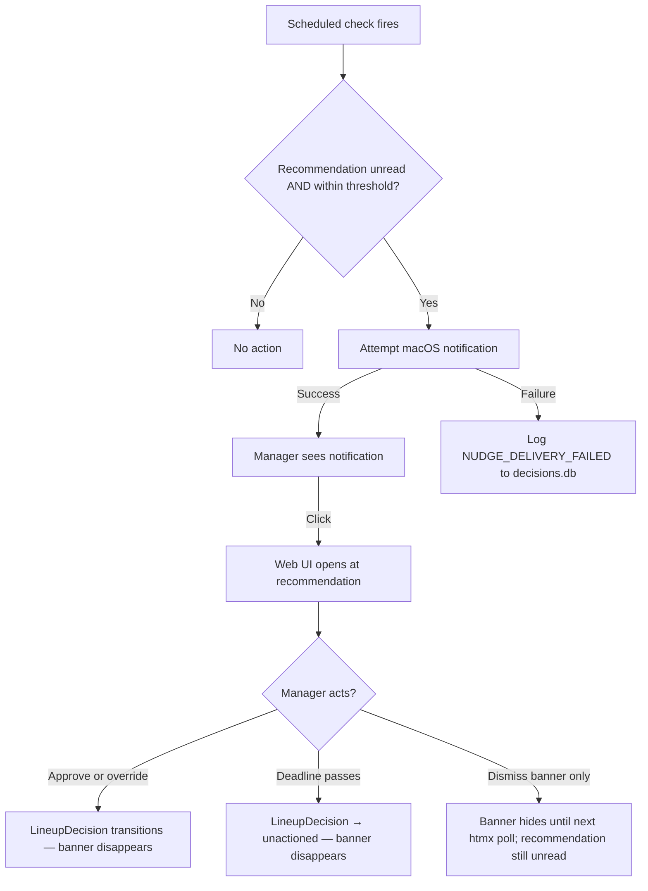

# UX — pre-kickoff-nudge

> Design system: **none registered** — all visual decisions below are
> assumptions; record them for reconciliation if a design system is added later.
> Prototype: **no prototype exists** — no screens have been reviewed by
> click-through. Every state below is an unreviewed assumption.

This slice has two delivery surfaces: a macOS system notification (primary,
fires without the app open) and a web UI alert banner (secondary, shown when
the app is already open). The cron/launchd check is what makes the notification
fire at the right time without requiring the manager to have opened the app.

---

## Screens and states

### Surface 1: macOS system notification  ·  prototype: not prototyped

The notification fires from a scheduled check script (launchd or cron). It does
not require the web app to be open.

| State | Trigger | What the manager sees | Action |
|---|---|---|---|
| Nudge fires | Unread recommendation + within threshold | Notification with title "Fantasy GM" and body showing time remaining | Click opens the web UI at the recommendation |
| No notification | Recommendation acted on, or no recommendation, or deadline passed | Nothing | — |
| Delivery failed | `osascript` unavailable or permission denied | Nothing visible — failure logged to decisions.db | — |

**Assumption:** macOS notification via `osascript -e 'display notification …'`
is the delivery mechanism. Requires "Fantasy GM" (or the terminal) to have
notification permission in System Settings.

### Surface 2: web UI alert banner  ·  prototype: not prototyped

Shown at the top of every web page when the app is open, a recommendation is
unread, and kickoff is within the threshold. Disappears once the recommendation
is acted on (approve or override).

| State | Trigger | What the manager sees | Exits |
|---|---|---|---|
| Banner visible | App open + unread recommendation + within threshold | Amber alert banner with countdown and link | Click link, dismiss (records nothing — recommendation remains unread) |
| Banner hidden | Recommendation acted on, deadline passed, or outside threshold | No banner | — |

**Assumption:** The banner is a Jinja2 partial injected into the base template,
using htmx polling every 60 seconds to re-check state without a full page load.
No design system component exists — this is a **NEW COMPONENT**.

---

## Flow

---

## Component mapping

| UI element | Component | Source | Notes |
|---|---|---|---|
| macOS notification | `osascript` system call | macOS | **ASSUMPTION** — requires notification permission |
| Web alert banner | **NEW COMPONENT** | — | Jinja2 partial + htmx poll; no design system match |
| Banner dismiss button | **NEW COMPONENT** | — | Does not change recommendation state |
| Countdown text in banner | inline text | — | Computed server-side on each poll |
| Link to recommendation | `<a>` / htmx boost | htmx | Follows existing nav pattern |

---

## Content

| Key | Copy |
|---|---|
| `notification.title` | Fantasy GM |
| `notification.body` | Lineup recommendation unread — kickoff in {N} hours {M} min |
| `notification.subtitle` | Open the app to approve or override |
| `banner.body` | Lineup recommendation unread — kickoff in {N} hours {M} min |
| `banner.cta` | Review now |
| `banner.dismiss` | Dismiss |
| `error.NUDGE_DELIVERY_FAILED` | (no user-facing copy — logged to decisions.db only) |

---

## Interaction

| Question | Decision |
|---|---|
| Banner polling interval | 60 seconds via htmx `hx-trigger="every 60s"` — **ASSUMPTION** |
| Dismiss behaviour | Hides banner until next poll; does not change recommendation state |
| Keyboard reachable | "Review now" link is keyboard-focusable; dismiss button is keyboard-reachable |
| Notification click | Opens `http://localhost:{port}/lineup` in the default browser |

---

## Accessibility

| Concern | Requirement |
|---|---|
| Banner role | `role="alert"` so screen readers announce it on appearance |
| Contrast | Amber banner text meets WCAG AA — **ASSUMPTION** pending actual colour values |
| Focus | Banner does not steal focus on appearance; manager navigates to it intentionally |

---

## Responsive

Single-user personal tool, loopback-only (NFR-11). No breakpoints designed —
the app targets desktop Safari/Chrome at a single window size. **ASSUMPTION.**

---

## Open design questions

| # | Question | Owner | Blocks |
|---|---|---|---|
| DQ-1 | Does the macOS notification require a dedicated launchd plist, or is a Sunday-morning cron entry sufficient? | R-01 | Affects how the check script is installed (design artifact) |
| DQ-2 | Should the banner also appear on the recommendation page itself, or only on non-recommendation pages? | R-01 | UX only — no spec impact |
| DQ-3 | Should dismissing the banner for a session (without acting) ever record a note in the log? | R-01 | May add a scenario to specs if yes |
