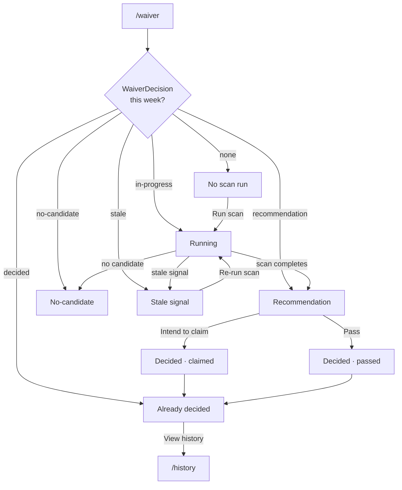

# UX — S-003 (waiver-add-worth-making)

> **Design system:** none registered — all component choices are assumptions; `/frictionless:build:design-intake` would codify them.
> **Prototype:** no prototype exists — these screens have not been reviewed by clicking through them.

## Screens and states

### Screen: Waiver Decision  ·  route: `/waiver`  ·  not prototyped

| State | Trigger | What the manager sees | Exits |
| --- | --- | --- | --- |
| No scan run | No WaiverDecision for current week | Empty state: "No waiver scan for this week yet." + "Run scan" button | → Running |
| Running | Scan triggered, not yet complete | Loading indicator: "Scanning waiver wire…"; all actions disabled | → Recommendation, → No-candidate, → Stale |
| Recommendation | Scan complete, candidate cleared all bars | Candidate name + displaced player name + value margin; brief (collapsed); "Intend to claim" and "Pass" buttons | → Decided |
| No-candidate | Scan complete, no candidate cleared all bars | "No add worth making this week." + closest candidate name, which bar it failed, and margin (e.g. "J. Smith cleared the relative bar but ranked 38th — 2 spots outside the absolute tier.") | read-only |
| Stale signal | Signal age exceeded freshness threshold at scan time | "Scan could not complete — [source] data is too old." + "Re-run scan" button; no recommendation | → Running |
| Already decided | WaiverDecision exists with human_response set | Recorded outcome ("Claimed" or "Passed"), candidate name, timestamp; no action buttons | → /history |

*Every state here except Already-decided corresponds to a scenario in the specs. Already-decided has no spec scenario — it is a UI guard only; the decision ledger is immutable once written.*

## Flow

## Component mapping

No design system is registered. All entries below are assumptions and must be reconciled when one is registered.

| UI element | Component | Notes |
| --- | --- | --- |
| Page container | Existing `<main>` layout | Assumption: matches `/history` page shell |
| Loading indicator | **NEW COMPONENT** | A spinner or skeleton — pattern not yet defined |
| Empty / no-scan state | **NEW COMPONENT** | Centred text + primary button — no existing empty-state pattern |
| Recommendation card | **NEW COMPONENT** | Named candidate, displaced player, value margin, collapsible brief |
| Brief (collapsed/expanded) | **NEW COMPONENT** | Toggle, htmx `hx-get` to fetch analysis detail |
| "Intend to claim" button | `<button type="submit">` (primary) | Assumption: styled to match approval actions in `/history` |
| "Pass" button | `<button type="submit">` (secondary) | Same form, different value |
| No-candidate display | Inline text block | No card needed; closest-miss detail inline |
| Stale signal banner | **NEW COMPONENT** | Distinct from nudge banner; includes named source and re-run action |
| Already-decided display | Read-only summary block | Assumption: reuses decision-record display from `/history` |

## Content

| Key | Copy |
| --- | --- |
| `waiver.no_scan.title` | No waiver scan for this week yet. |
| `waiver.no_scan.cta` | Run scan |
| `waiver.running` | Scanning waiver wire… |
| `waiver.recommendation.cta_claim` | Intend to claim |
| `waiver.recommendation.cta_pass` | Pass | Records `HumanResponse.DECLINED` |
| `waiver.no_candidate.title` | No add worth making this week. |
| `waiver.already_decided.claimed` | You recorded intent to claim [candidate] on [date]. |
| `waiver.already_decided.passed` | You passed on the waiver wire this week on [date]. |
| `error.SIGNAL_STALE` | Scan could not complete — [source] data is too old. |
| `error.SIGNAL_MISSING_PROVENANCE` | Scan could not complete — a signal is missing its source or timestamp. |

## Interaction

| Question | Decision |
| --- | --- |
| Scan trigger | Button POST to `/api/waiver/scan`; page polls `/api/waiver/status` via htmx every 5 s during Running state |
| Claim/Pass submission | Form POST to `/api/waiver/decide`; redirects to `/waiver` which then shows Already-decided |
| Brief expand/collapse | htmx `hx-get="/api/waiver/brief"` on toggle; response swapped inline |
| Keyboard reachable | "Run scan", "Intend to claim", "Pass", brief toggle — all reachable via Tab; submit on Enter |
| Optimistic vs pending | Pending — claim intent must be confirmed before state changes |

## Accessibility

| Concern | Requirement |
| --- | --- |
| Roles and labels | Recommendation card has `role="region"` with candidate name as label |
| Loading announcement | Running state announces via `aria-live="polite"` region |
| Button states | "Intend to claim" and "Pass" disabled and `aria-disabled="true"` during submission |
| Focus order | Follows visual order; no traps |
| Contrast | Assumption: meets WCAG AA — no tokens registered to verify against |

## Responsive

| Breakpoint | Layout change |
| --- | --- |
| < 640px | Recommendation card stacks vertically; buttons become full-width |
| ≥ 768px | Brief expands to right of candidate card |

## Open design questions

| # | Question | Owner | Blocks |
| --- | --- | --- | --- |
| DQ-1 | Can the manager re-run the scan after passing (to check for a better candidate later that day)? A second run writes a second WaiverDecision record. | R-01 | Already-decided state behaviour |
| DQ-2 | Should the stale-signal banner reuse the same pattern as the nudge banner, or be visually distinct? | R-01 | NEW COMPONENT decision |
