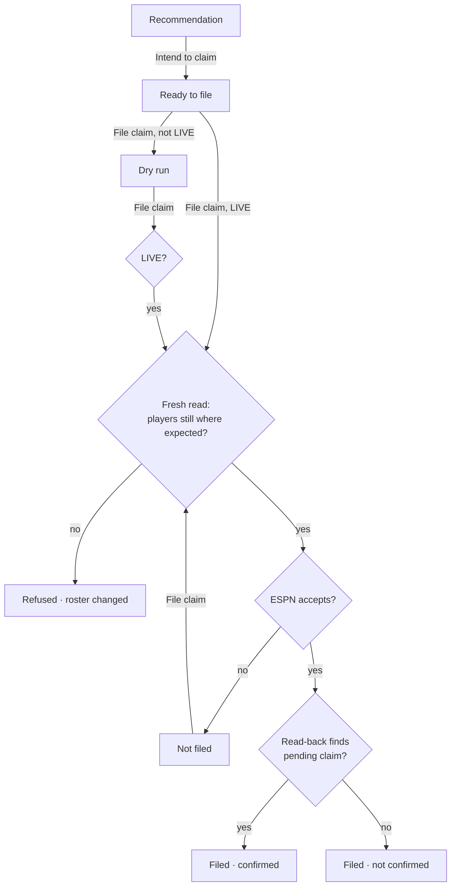

# UX — waiver-claim-filed

> **Design system:** none registered — component choices follow the existing
> pages and are assumptions.
> **Prototype:** no prototype exists — these states have not been reviewed by
> clicking through them.

## Screen: Waiver Decision · route `/waiver` · not prototyped

This slice replaces the "Already decided · claimed" state with a filing step.
"Already decided · passed" is unchanged.

| State | Trigger | What the manager sees | Exits |
| --- | --- | --- | --- |
| Ready to file | Decision approved ("Intend to claim"), no live filing yet | "You intend to claim **{add}**, dropping **{drop}**." + the confirmation box and **File claim** button | → Dry run, → Filed, → Not filed, → Refused |
| Dry run | Filed with anything but `LIVE` | "Dry run — nothing was sent." + the exact transaction in plain words ("Add {add} · Drop {drop} · waiver claim for week {week}") + the form again | → any filing state |
| Filed · confirmed | Live send, read-back finds a pending claim with the same players | "Claim filed — ESPN shows it as pending. You are {rank} of {teams} in waiver priority." No form | → `/history` |
| Filed · not confirmed | Live send accepted, read-back cannot find it | Warning banner: "ESPN accepted the claim but it doesn't show on the league yet. Check the ESPN app before doing anything — don't file again, or you may end up with two claims." No form | → ESPN app |
| Not filed | ESPN rejected the send, or the connection never opened | Banner: "The claim was not filed — {error}." + "File it in the ESPN app yourself: add {add}, drop {drop}." + the form again | → any filing state |
| Refused · roster changed | Fresh read shows the drop is off my roster or the add is no longer available | Banner: "Nothing was sent — {player} {is no longer on your roster / is no longer available}." + "Re-run scan" | → Running scan |
| Refused · not approved | A filing request for a decision that is not approved (only by a hand-built request) | Banner: "This decision is {state}, not approved — nothing was sent." | read-only |
| Refused · already filed | A filing this week is in progress, confirmed or unconfirmed — including after a re-run scan | Banner: "This week's claim was already filed — nothing was sent." | read-only |
| Refused · league unreadable | The fresh re-check read failed | Banner: "Couldn't read the league to re-check the claim — nothing was sent. Try again in a moment." + the form | → any filing state |
| Filing | Request in flight | **File claim** disabled until the response arrives | → any filing state |

Every state above has a spec scenario except **Filing**, which is a button
state, not system behaviour.

## Flow

## Components

| Element | Build as | Source |
| --- | --- | --- |
| Confirmation box + **File claim** | `<form>` with a text input and a `btn btn--danger` submit | Same as the lineup write step's `partials/execute_form.html`; posts to the waiver filing route |
| Dry run / confirmed message | `
` with `tag tag--quiet` / `tag tag--chyron` | Same as `partials/execution_result.html` |
| Not filed / refused | `
` | Existing banner |
| Not confirmed | `
` | Added by the waiver scan slice |

No new components.

## Content

| Element | String |
| --- | --- |
| Ready to file | "You intend to claim **{add}**, dropping **{drop}**." |
| Confirmation label | "Type LIVE to file this claim with ESPN. Anything else is a dry run." |
| Button | "File claim" |
| Dry run | "Dry run — nothing was sent. Add {add} · Drop {drop} · waiver claim for week {week}." |
| Confirmed | "Claim filed — ESPN shows it as pending. You are {rank} of {teams} in waiver priority." |
| Not confirmed | "ESPN accepted the claim but it doesn't show on the league yet. Check the ESPN app before doing anything — don't file again, or you may end up with two claims." |
| Not filed | "The claim was not filed — {error}. File it in the ESPN app yourself: add {add}, drop {drop}." |
| Roster changed | "Nothing was sent — {player} is no longer on your roster." / "Nothing was sent — {player} is no longer available." |

## Interaction

- The form posts with htmx and swaps the filing area; the form disables its
  button while the request is in flight (`hx-disabled-elt="find button"`), so a
  double click cannot file twice.
- After a live filing (confirmed or not) the form is not rendered again.
