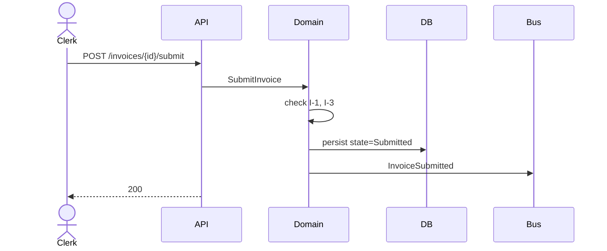

# Design — <slice-id>

How to build it, and how to test it. Both halves — a build approach without a
test approach produces tests written against the implementation.

## Context

<Only the current state and constraints needed to explain the approach.
Reference intent.md for motivation rather than restating it.>

---

# Build approach

## Where the code goes

| Concern | Location | Pattern it follows |
| --- | --- | --- |

<Read neighbouring code first and match it. New patterns need a reason.>

## Components

Every component this slice adds or changes. **This table drives the implementation
tasks and the code review checklist** — a component not listed here that appears
in the diff is a finding.

| Component | Action | Notes |
| --- | --- | --- |
| `InvoiceSubmitHandler` | CREATE | New API handler |
| `InvoiceDraftForm` | MODIFY | Add submit action and error state |
| `Invoice` | MODIFY | Add `submit()` method enforcing I-1, I-3 |

Actions: `CREATE` · `MODIFY` · `REMOVE`. For interface slices, every element
flagged `NEW COMPONENT` in `ux.md` must appear here as `CREATE`.

## UI approach

<Interface slices only. Omit this section entirely for a backend slice.>

> Design system: <name + version from `design-system.mjs context`, or
> **none registered** — say so; do not invent one.>
> Style guide: <location> · Component library: <location>
> Prototype: <mode + screens, from `prototype.mjs for-slice <slice-id>`, or
> **none covering this slice**.>

Carry `ux.md`'s component mapping forward into buildable form. `ux.md` says
*which* component; this says *where it comes from and how it is used*.

| UI element | Library component | Import from | Variant / props | Prototype screen |
| --- | --- | --- | --- | --- |
| Line item table | `DataTable` | `@acme/ui` | `density="compact"` | `invoice-draft` |
| Submit | `Button` | `@acme/ui` | `variant="primary"`, `pending` | `invoice-draft` |
| Error banner | `Alert` | `@acme/ui` | `severity="error"` | not prototyped |

**Every element in `ux.md`'s mapping appears here.** A row missing from this
table is an element the implementer will hand-roll.

In `target-stack` mode, name the prototype **file** each screen starts from as
well — that code was reviewed, and rebuilding it from scratch discards the
review. In `standalone` mode the prototype is a visual and flow reference only:
take the layout, states, flow and copy; write the implementation fresh.

### Style rules that apply

| Concern | Rule | From |
| --- | --- | --- |
| Spacing | 8px scale; no arbitrary values | style guide |
| Colour | Semantic tokens only — `--color-danger`, never `#d32f2f` | tokens |
| Typography | `text-body`, `text-heading-2`; no ad-hoc sizes | style guide |

Hardcoded values where a token exists are a code review finding. If no token
covers the need, that is a design system gap — record it below, do not paper
over it with a literal.

### New components

Every element flagged `NEW COMPONENT` in `ux.md`.

| Component | Where it lives | Follows the pattern of | Promote to library? |
| --- | --- | --- | --- |
| `RunningTotal` | `src/features/invoice/` | `SummaryRow` in `@acme/ui` | Propose after this slice |

A new component built without naming an existing pattern to follow is how a
design system acquires a second, undocumented dialect.

## Domain

| Aggregate | Invariant it enforces here | Transaction boundary |
| --- | --- | --- |
| `Invoice` | I-1, I-3 | One aggregate, one transaction |

<If a use case needs two aggregates changed atomically, it is a policy with
eventual consistency — say so and name the policy.>

## Contracts

| Contract | Change | Breaking? | Consumers to notify |
| --- | --- | --- | --- |

## Data and migrations

| Change | Forward | Rollback |
| --- | --- | --- |

## Decisions

| Decision | Chosen | Rejected, and why |
| --- | --- | --- |

## Risks

| Risk | Mitigation |
| --- | --- |

## Sequence



---

# Test approach

## Scenario coverage

Every scenario in `specs/**/*.md` gets a row, keyed by its id. Every AC from
`intent.md` appears in at least one row. **A scenario with no row is the defect
this section exists to prevent.**

| Scenario | AC | Level | Test file | Test name | Status |
| --- | --- | --- | --- | --- | --- |
| INVSUB-01 | AC-1 | integration | `tests/integration/invoice.test.ts` | `INVSUB-01: submitting a valid draft publishes InvoiceSubmitted` | required |
| INVSUB-02 | AC-2 | unit | `src/domain/invoice.test.ts` | `INVSUB-02: submitting an empty invoice is rejected` | required |
| INVSUB-03 | AC-3 | integration | `tests/integration/invoice.test.ts` | `INVSUB-03: resubmitting is idempotent` | required |
| INVSUB-04 | AC-4 | performance | `tests/perf/submit.k6.js` | `INVSUB-04: submit p99 under 300ms at 200 rps` | required |

**The scenario is the unit of coverage, not the AC.** One AC routinely carries
several scenarios, and keying this table on the AC is how N−1 of them ship with
no test while the table still looks complete.

**One test per row.** A second case is a second row. "Plus the rollback case"
in a notes column is not coverage — it is a promise no script can read, and it
is exactly how a scenario ships untested.

`Status` is `required` or `waived`, and nothing else. It states INTENT, not
state: whether coverage is actually there is derived by `trace.mjs check`,
which greps the tests. Do not hand-maintain a `covered` flag — a status cell a
human types is a claim nobody verifies, which is the defect this table exists
to prevent.

`waived` needs a matching row in **Not covered by automated tests** giving the
reason and how it is checked instead. The script cross-checks that; goodwill
does not.

There is no Notes column on purpose. A constraint belongs in the scenario, and
a gap belongs in a waiver.

Test names start with the scenario id: `INVSUB-02: submitting an empty invoice
is rejected`. The id prefix is the contract; the prose after it is free. Keep
`AC-SIGNAL` for the one e2e acceptance-signal test.

Verify with:

```bash
node "${CLAUDE_PLUGIN_ROOT}/scripts/trace.mjs" check --phase planning   # before build
node "${CLAUDE_PLUGIN_ROOT}/scripts/trace.mjs" check --phase delivery   # after build
```

## Levels

| Level | What belongs here | What does not |
| --- | --- | --- |
| Unit | Invariants, state transitions, pure logic | Anything needing a database |
| Integration | Command → aggregate → persistence → event | UI |
| Contract | Request/response and event payloads against `contracts/**` | Business rules |
| E2E | The acceptance signal, once | Every permutation |

## Fixtures and test data

| Fixture | Why it must be realistic |
| --- | --- |

## NFR verification

| NFR | Budget | Measured how | Where it runs |
| --- | --- | --- | --- |
| Latency | p99 < 300ms @ 200 rps | k6 scenario | CI, nightly |

<An NFR with no row here will not be measured, and an unmeasured NFR is not a
passed NFR.>

## Not covered by automated tests

Every `waived` row in the coverage table appears here, by its scenario id.

| What | Why | How it is checked instead |
| --- | --- | --- |
| INVSUB-05 | Supplier portal is a third-party sandbox with no test tenant | Manual check on the release checklist, recorded in the run log |

State this here, or it gets discovered in production.

## Open questions

<Only genuinely deferrable unknowns. If a question would change the specs, the
approach, or the task breakdown, resolve it now — ask rather than guess.>
