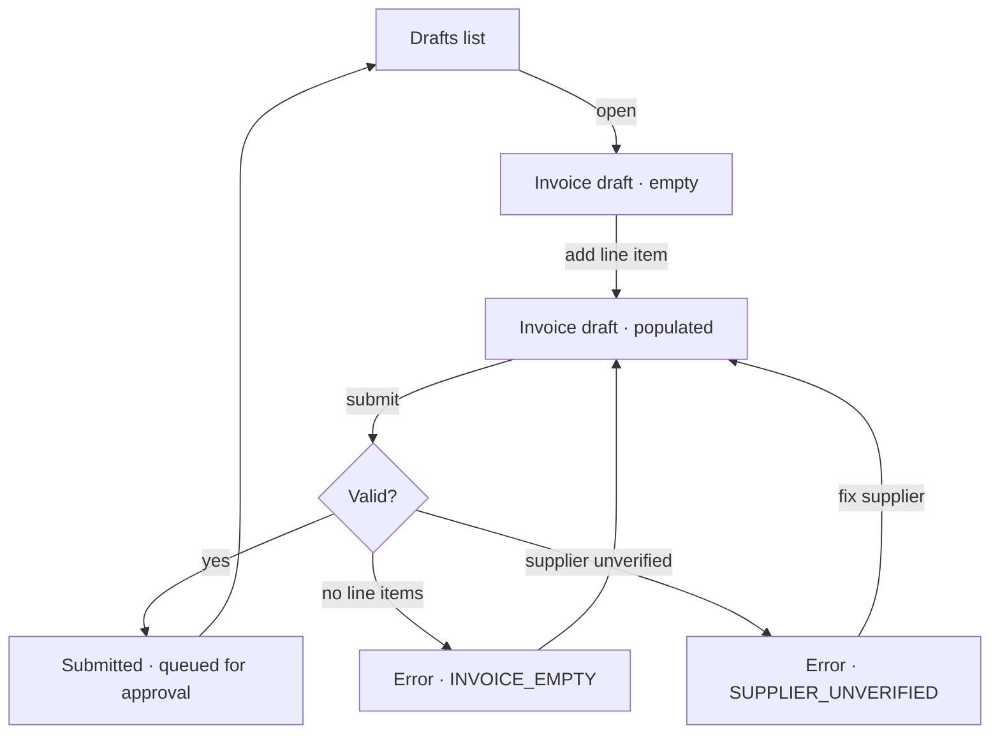

# UX — <slice-id>

> Only for slices that touch a user interface.
> Design system: <name + version, from `design-system.mjs context`, or
> **none registered** — say so rather than inventing one.>
> Prototype: <mode + screen ids, from `prototype.mjs for-slice <slice-id>`;
> **outside the prototype's scope** or **no prototype** — they are different,
> and only the second means nobody has reviewed these screens.>

## Screens and states

Every screen this slice touches, and every state it can be in. The states
nobody specifies are the states that ship broken.

### Screen: <Invoice draft>  ·  prototype: `invoice-draft`

| State | Trigger | What the user sees | Exits | Prototype |
| --- | --- | --- | --- | --- |
| Empty | No line items yet | Empty state + "Add a line item" primary action | Add item | ✔ |
| Populated | ≥1 line item | Table + running total + Submit enabled | Submit, Discard | ✔ |
| Submitting | Submit pressed | Submit shows pending; form locked | → Submitted, → Error | ✔ |
| Error — empty | `INVOICE_EMPTY` | Inline error on the line-item table | Add item | ✔ |
| Error — unverified | `SUPPLIER_UNVERIFIED` | Banner with a link to the supplier | Fix supplier | not prototyped |
| Permission denied | Actor lacks the role | Submit hidden, not disabled | — | ✔ |

Errors here must match the codes in the spec exactly.

`Prototype` is `✔` when the prototype registered that state, `not prototyped`
when it did not, and `retired: <reason>` when it did and this slice is
deliberately dropping it. A registered state that quietly disappears from this
table is one the stakeholder still believes was agreed.

## Flow

Include the exits. A flow with no way out is a flow that traps someone.

Where the prototype registered a flow for this slice, this diagram matches its
steps — or names the step that changed and why.

## Component mapping

| UI element | Component | Source | Notes |
| --- | --- | --- | --- |
| Line item table | `DataTable` | design system | dense variant |
| Submit | `Button` (primary) | design system | pending state supported |
| Error banner | `Alert` (error) | design system | |
| Running total | **NEW COMPONENT** | — | No match in the library. This is a design decision, not an implementation detail — needs a decision before build. |

Flag every unmatched element as **NEW COMPONENT**. Silently improvising one is
how design systems rot.

## Content

The actual strings. Placeholder copy becomes shipped copy.

| Key | Copy |
| --- | --- |
| `invoice.draft.empty.title` | No line items yet |
| `invoice.draft.empty.body` | Add at least one line item before submitting. |
| `invoice.submit.cta` | Submit for approval |
| `error.INVOICE_EMPTY` | Add at least one line item. |
| `error.SUPPLIER_UNVERIFIED` | This supplier needs verification before you can submit. |

## Interaction

| Question | Decision |
| --- | --- |
| Validation timing | On submit, not on blur |
| Optimistic or pending | Pending — the event must be confirmed |
| Focus after error | First invalid field |
| Keyboard reachable | Every action; Submit is `Enter` from the table |
| Destructive confirmation | Discard requires a confirm step |

## Accessibility

| Concern | Requirement |
| --- | --- |
| Roles and labels | Table has a caption; Submit has an accessible name |
| Focus order | Follows visual order; no traps |
| State-change announcement | Submission result announced via a live region |
| Contrast | Meets WCAG AA against both themes |
| Motion | Respects `prefers-reduced-motion` |

## Responsive

| Breakpoint | Layout change |
| --- | --- |
| < 640px | Table collapses to stacked cards; Submit becomes a sticky footer action |
| ≥ 1024px | Summary moves to a right rail |

## Open design questions

| # | Question | Owner | Blocks |
| --- | --- | --- | --- |

---

Every state named here needs a scenario in the specs, or a stated reason it
does not.

Where this document and the prototype disagree, decide which is wrong before
changing either. Where this document and the specs disagree, the specs win.
